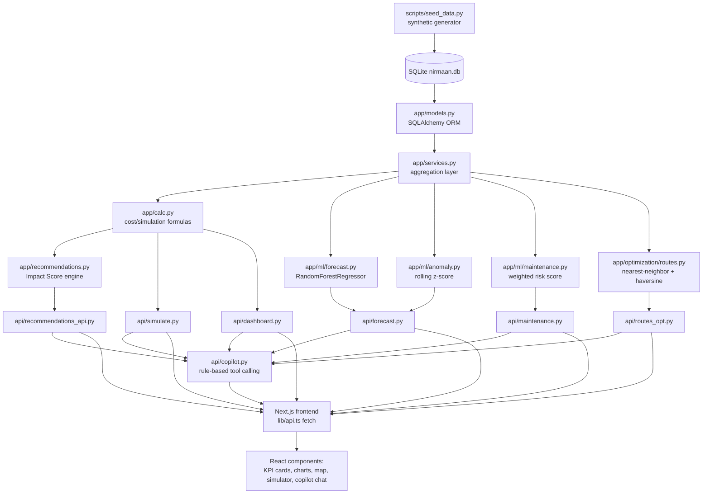

# NIRMAAN AI — System Design Walkthrough

## 1. Overview

NIRMAAN AI is a two-tier application: a FastAPI backend holding all data
and computation, and a Next.js frontend that renders it. There is no
message queue, no background job scheduler, and no separate ML-serving
layer — every model (forecast, anomaly, maintenance risk) is light
enough to retrain/run inline on each request against the current
dataset. This was a deliberate simplicity choice for a system this size
and a hackathon time budget: it removes an entire class of "stale model"
or "cache invalidation" bugs.

## 2. Data flow



Equivalent ASCII summary, same components:

```
seed_data.py --> SQLite (nirmaan.db)
                     |
                     v
              SQLAlchemy models
                     |
                     v
         services.py (aggregation/query layer)
                     |
          -----------+-----------------------------
          |          |            |               |
      calc.py     ml/forecast  ml/anomaly    ml/maintenance
    (cost/sim        .py          .py            .py
     formulas)        |            |               |
          |           v            v               v
          +------> FastAPI routers (api/*.py)
                          |
                          v
                   Next.js frontend (fetch)
                          |
                          v
                  React components / charts / map
```

Every number the frontend displays traces back through exactly one of
these paths — there is no second, parallel source of "cost" or "waste"
numbers anywhere in the system. That single-source-of-truth property is
the main architectural invariant the design protects.

## 3. Components

### `app/core.py` — settings & shared assumptions

Holds the SQLAlchemy engine/session factory (`DATABASE_URL` env-driven,
defaults to local SQLite) and the `ASSUMPTIONS` dict: every cost constant
(fuel price, labour rate, tipping fees, etc.) used anywhere in the
system. Centralizing these means changing a cost assumption changes it
everywhere consistently, and the numbers are auditable in one place
rather than scattered through the codebase.

### `app/models.py` — schema

13 SQLAlchemy models: `Zone`, `Location`, `Bin`, `Vehicle`,
`WasteRecord`, `CollectionEvent`, `MaintenanceRecord`, `CostRecord`,
`DataProvenance`. Deliberately no `User`/auth tables (single-instance
demo) and no persisted `predictions`/`scenarios` tables — forecasts and
simulations are computed on demand from the raw history and returned
directly, never cached, so there's no possibility of a stale cached
prediction disagreeing with a fresh one.

### `app/calc.py` — the unified calculation layer

The single most important module. `apply_simulation(baseline, inputs)`
takes a baseline physical-quantity snapshot (kg by category, trip count,
average distance, overflow count, maintenance mix) and a set of five
"adoption levers," and returns a full recomputed waste/cost breakdown.
It is pure (no I/O), so it's trivially unit-testable and is called
identically by: the dashboard's "potential saving" preview, the
recommendation engine (to estimate each intervention's impact), and the
`/api/simulate` endpoint the frontend's interactive slider UI hits. This
is what guarantees a recommendation's claimed saving and the live
simulator's output can never silently diverge.

### `app/services.py` — aggregation layer

Turns ORM rows into the metrics dicts `calc.py` and the ML modules
consume: 30-day baseline metrics per zone, zone summaries, high-risk-bin
scoring, and the route-optimization-for-a-zone helper. This is the only
layer that writes SQL/ORM queries — everything downstream works with
plain dicts/DataFrames.

### `app/ml/forecast.py` — waste forecasting

A `RandomForestRegressor` trained per request on a zone's own daily
history (day-of-week, month, trend index, 7-day lag, population
features). Confidence interval comes from held-out residual spread, not
an assumption. Falls back to a documented average when history is too
short (<21 days) to support a trained model honestly.

### `app/ml/anomaly.py` — anomaly detection

Rolling 14-day z-score per zone; flags |z| ≥ 2. A std floor relative to
the rolling mean prevents divide-by-near-zero blowups on unusually flat
history while still catching genuine spikes.

### `app/ml/maintenance.py` — predictive maintenance

A weighted (not trained) risk score: 25% mileage-vs-fleet-average, 30%
days-overdue-for-service, 30% recent-emergency-repair-frequency, 15%
downtime trend. Explicitly documented as a transparent heuristic, not a
calibrated failure probability — the dataset doesn't support claiming
otherwise honestly.

### `app/optimization/routes.py` — route optimization

Haversine distance + nearest-neighbor heuristic, compared against the
baseline (given) stop order. Explicitly flagged everywhere as estimated
straight-line distance, not real road routing.

### `app/recommendations.py` — recommendation engine

For each zone, conditionally proposes interventions (segregation if
mixed-waste share is high, composting if wet-waste share is high, a
commercial program if overflow is high in a commercial/mixed zone), each
scored by a documented Impact Score formula:

```
impact_score = expected_waste_reduction_pct
             + expected_monthly_saving / 1000
             + feasibility_score
             - implementation_cost / 1000
             - operational_risk_score
```

### `app/api/*.py` — FastAPI routers

Thin HTTP layer: `dashboard`, `forecast`, `maintenance`, `routes_opt`,
`recommendations_api`, `simulate`, `map_data`, `copilot`. No business
logic lives here — each handler calls into `services`/`calc`/`ml` and
shapes the response.

### `app/api/copilot.py` — rule-based AI Copilot

Keyword-matches the question to one of five grounded "tools"
(cost summary, zone priority, maintenance priority, recommendations,
segregation what-if simulation) and fills a template with that tool's
real output. No external LLM call — this was a deliberate choice: it
cannot hallucinate a number it didn't actually compute, and it has zero
runtime dependency on an API key or network access.

### Frontend (`frontend/app/page.tsx` + `components/`)

A single client-rendered dashboard page. On load, it fetches the
dashboard summary, zone list, anomalies, maintenance risk, and map bins
in parallel; selecting a zone triggers a second fetch wave (trend,
forecast, route optimization) scoped to that zone. The simulator
component owns its own slider state and debounces calls to
`/api/simulate` as the user drags. The map is dynamically imported with
`ssr: false` (Leaflet requires the browser `window`/DOM).

## 4. Why these model/algorithm choices

- **RandomForest over Prophet/LSTM for forecasting**: the dataset is one
  zone's daily history at a time (a few hundred points) — a forest
  trained in milliseconds with no hyperparameter tuning outperforms a
  heavier time-series model on data this size, and retraining per
  request removes staleness risk entirely.
- **Rolling z-score over Isolation Forest for anomalies**: explainability
  was a hard requirement ("why was this flagged"); a z-score's
  explanation is the comparison itself, with nothing to translate from a
  learned decision boundary.
- **Weighted score over a trained classifier for maintenance risk**: a
  synthetic dataset's "failure" labels are themselves synthetic — training
  a classifier on them and presenting its output as a calibrated
  probability would overstate what the data can actually support.
  A documented weighted formula is honest about being a heuristic.
- **Nearest-neighbor heuristic over full VRP solver (OR-Tools) for
  routing**: the honesty requirement here was about distance realism
  (straight-line, disclosed), not solver sophistication — a full VRP
  solver optimizing fake distances wouldn't have produced more credible
  numbers, just slower ones.
- **Rule-based over LLM-backed copilot**: zero hallucination risk, zero
  external dependency, and the hackathon's own guidance explicitly
  prefers a working rules-based engine over a chatbot that might not
  function reliably during judging.

## 5. Cost-calculation methodology

All costs flow through `calc.py`'s documented assumptions
(`app/core.py::ASSUMPTIONS`): fuel ₹/litre × route distance / fuel
efficiency, labour ₹/hour × crew size × route duration, vehicle wear
₹/km, landfill tipping fee ₹/kg, composting cost ₹/kg (cheaper, no
tipping fee), recycling revenue ₹/kg (negative cost), overflow penalty
₹/incident, and scheduled vs. emergency repair cost (with emergency at a
documented multiplier plus downtime cost ₹/hour). Every simulation lever
changes one or more of these inputs directly (e.g., segregation adoption
moves kg between categories; route efficiency reduces distance per
trip) rather than applying a fudge factor to a final total — this is
what makes the simulator's output traceable back to a specific physical
change, not an opaque percentage adjustment.

## 6. Validation

Actual commands run against this repository during final release
verification (2026-10-10), with real results:

```
cd backend && source venv/Scripts/activate && python -m pytest tests/ -q
  -> 13 passed in 3.12s
```

Covers `tests/test_calc.py` (cost/simulation formulas: mass conservation
under segregation, overflow-risk direction under reduced collection
frequency, composting/route-optimization/maintenance-shift cost
effects), `tests/test_ml.py` (forecast fallback vs. trained-model paths,
anomaly detection on an injected spike, maintenance score ordering for a
degrading vs. healthy vehicle), and `tests/test_optimization.py`
(haversine distance sanity, optimized route never worse than baseline).

```
cd frontend && npm run build
  -> Compiled successfully; TypeScript check passed; static pages generated
```

Targeted numerical-consistency spot checks (direct API calls against
the running backend, not just unit tests):

- `POST /api/simulate {"collection_frequency_change_pct": -30}` —
  overflow incidents rose (189 → 268.4) under fewer trips, confirming
  fewer collection trips increase rather than decrease overflow risk.
- `POST /api/simulate {"segregation_adoption_pct": 40}` — total waste
  kg was unchanged between baseline and simulated (111,545.7 both sides),
  confirming segregation reclassifies waste between categories rather
  than double-counting or deleting mass.
- `GET /api/routes/optimize/4` — optimized distance (71.69 km) was less
  than or equal to the baseline (149.96 km) for a real zone's bin set.
- `GET /api/dashboard/summary` and `POST /api/simulate {}` (default/baseline
  inputs) returned an identical `total_operating_cost` (₹1,365,872.41)
  from two different endpoints, confirming there is one calculation
  source, not two that could silently diverge.
- All 10 seeded zones returned HTTP 200 from `/api/forecast/zone/{id}`,
  `/api/routes/optimize/{id}`, and `/api/recommendations/zone/{id}`.

Browser-based UI verification was **not** performed in this environment
— no Chrome extension was connected to the automation tooling available
here. The build/type-check passing and the backend serving correct,
consistent data through manual `curl` checks is what was actually
verified; visually clicking through the rendered dashboard was not.

## 7. Limitations (honest summary)

- All data is synthetic (seeded, documented) — nothing here reflects a
  real deployment or measured outcome.
- Route distances are straight-line (haversine) estimates, not road
  routing.
- Forecasting is a RandomForest trained fresh per request on one zone's
  own history (at most ~365 points) — it has not been validated against
  out-of-distribution scenarios (e.g. a genuinely new zone) and should
  not be read as having production-grade generalization guarantees.
- Maintenance risk is an explainable weighted heuristic, not a
  calibrated failure-probability model.
- This is not a certified, production-deployed, or municipally-adopted
  system — it is a working hackathon prototype demonstrating a complete,
  internally consistent calculation pipeline end to end.
